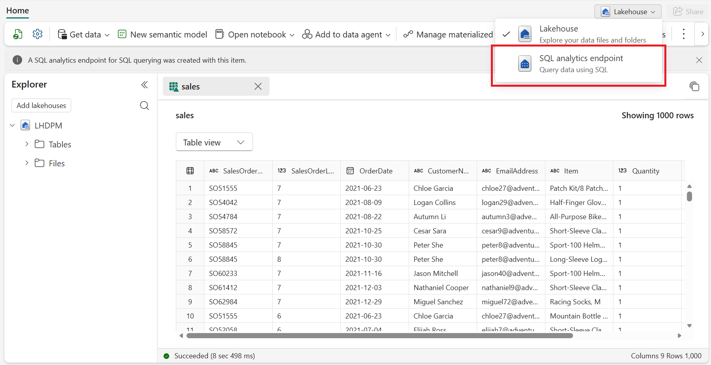
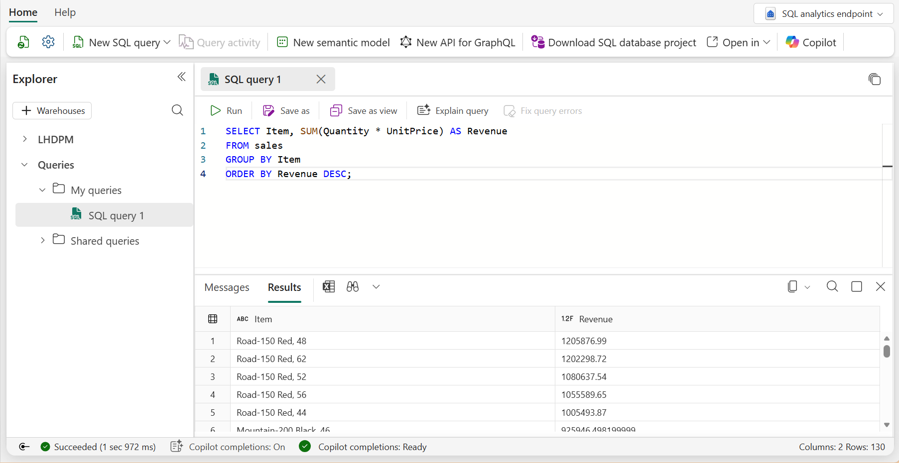
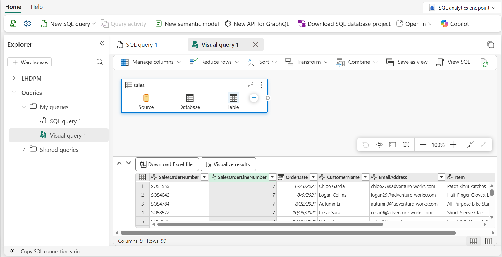
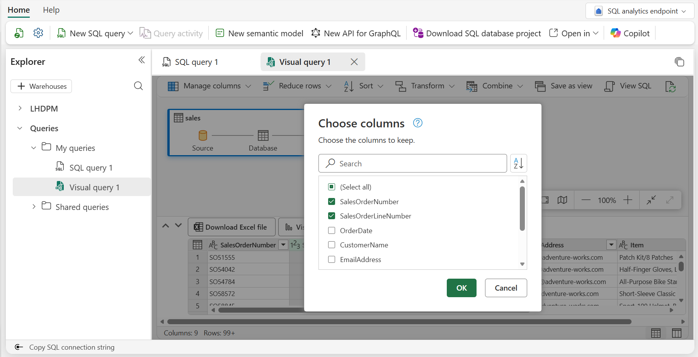
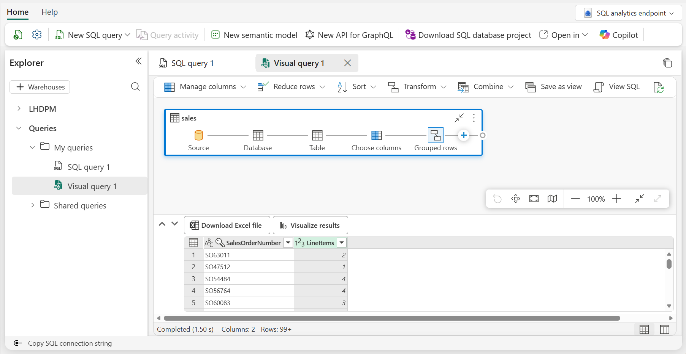
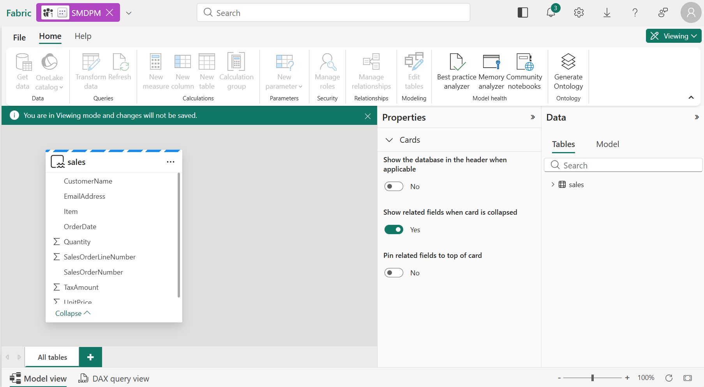
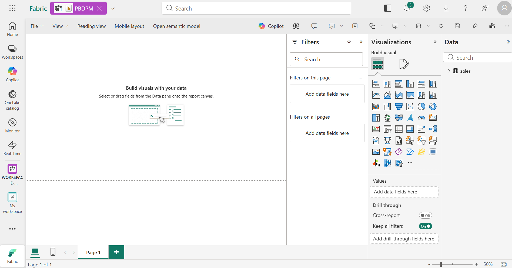
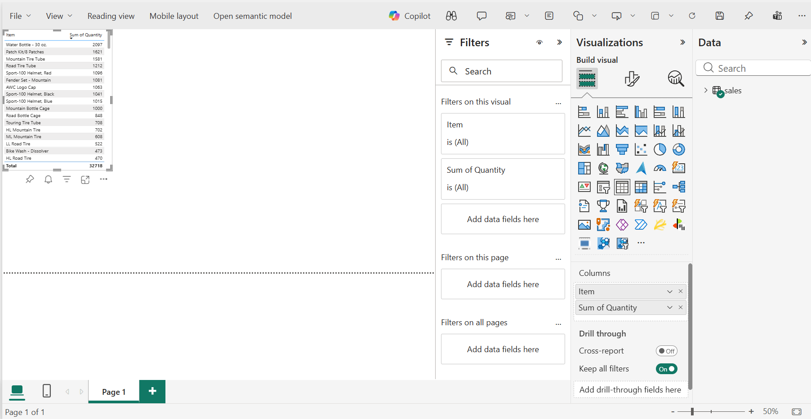
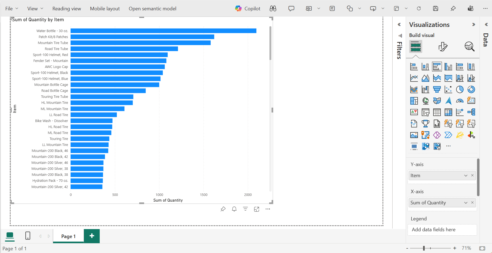

---
Lab:
    Title: 'Create a Microsoft Fabric Lakehouse'
    Module: 'Get started with lakehouses in Microsoft Fabric'
---

# Create a Lakehouse

Large-scale data analytics solutions have traditionally been built around a *data warehouse*, in which data is stored in relational tables and queried using SQL. The growth in "big data" (characterized by high *volumes*, *variety*, and *velocity* of new data assets) together with the availability of low-cost storage and cloud-scale distributed compute technologies has led to an alternative approach to analytical data storage; the *data lake*. In a data lake, data is stored as files without imposing a fixed schema for storage. Increasingly, data engineers and analysts seek to benefit from the best features of both of these approaches by combining them in a *data lakehouse*; in which data is stored in files in a data lake and a relational schema is applied to them as a metadata layer so that they can be queried using traditional SQL semantics.

In Microsoft Fabric, a lakehouse provides highly scalable file storage in a *OneLake* store (built on Azure Data Lake Store Gen2) with a metastore for relational objects such as tables and views based on the open source *Delta Lake* table format. Delta Lake enables you to define a schema of tables in your lakehouse that you can query using SQL.

This lab takes approximately **30** minutes to complete.

> **Note**: You'll need a Microsoft Fabric license to complete this exercise. See [Getting started with Fabric](https://learn.microsoft.com/fabric/get-started/fabric-trial) for details of how to enable a free Fabric trial license. You will need a Microsoft *school* or *work* account to do this. If you don't have one, you can [sign up for a trial of Microsoft Office 365 E3 or higher](https://www.microsoft.com/microsoft-365/business/compare-more-office-365-for-business-plans).

## Table of Contents

- [A. Open the shared lakehouse SQL analytics endpoint](#a-open-the-shared-lakehouse-sql-analytics-endpoint)
- [B. Use SQL to query tables](#b-use-sql-to-query-tables)
- [C. Create a visual query](#c-create-a-visual-query)
- [D. Create a report](#d-create-a-report)

> **Important – shared environment**: In this workshop all participants work in **one shared workspace and one shared lakehouse**, and the data has already been loaded for you into the **`scenario1`** schema, which is the same for everyone. To avoid overwriting each other's work, every item you create in the workspace (such as semantic models and reports) must carry your own identifier in the format **`<Name>_<Role>`** (for example `Budi_DataAnalyst`). You will reuse the same identifier in the following modules.

## A. Open the shared lakehouse SQL analytics endpoint

1. Sign into [Microsoft Fabric](https://app.fabric.microsoft.com) at `https://app.fabric.microsoft.com`.
2. At the bottom left, ensure that you have the **Fabric** icon, if it's still in **Power BI** icon, simply click and switch to the **Fabric** icon. If you do not see the **Fabric** icon, contact your Fabric administrator with a request to [enable Fabric](https://learn.microsoft.com/fabric/admin/fabric-switch).
3. In the menu bar on the left, select **Workspaces** and open the workshop workspace. The facilitator will announce the **workspace name** and the **lakehouse name** on the day.
4. In the workspace, open the shared lakehouse.
5. Note that the **Lakehouse explorer** pane on the left enables you to browse tables and files in the lakehouse:
    - The **Tables** folder contains tables that you can query using SQL semantics. Tables in a Microsoft Fabric lakehouse are based on the open source *Delta Lake* file format, commonly used in Apache Spark. Because this lakehouse has **schemas** enabled, tables are organized in schemas.
    - The **Files** folder contains data files in the OneLake storage for the lakehouse that aren't associated with managed delta tables. You can also create *shortcuts* in this folder to reference data that is stored externally.

6. Expand the **Tables** folder, then the **scenario1** schema, and verify that the **sales** table is available. The team has already loaded it for you.

> **Note**: **scenario1** is a shared schema. In this module you only read from it; do not modify or delete its tables.

## B. Use SQL to query tables

When you create a lakehouse and define tables in it, a SQL endpoint is automatically created through which the tables can be queried using SQL `SELECT` statements.

1. At the top-right of the Lakehouse page (just below your profile icon), you can choose from the dropdown to switch from **Lakehouse** to **SQL endpoint**. Then wait a short time until the SQL query endpoint for your lakehouse opens in a visual interface from which you can query its tables, as shown here:

    

2. Use the **New SQL query** button to open a new query editor, and enter the following SQL query:

    ```sql
   SELECT Item, SUM(Quantity * UnitPrice) AS Revenue
   FROM scenario1.sales
   GROUP BY Item
   ORDER BY Revenue DESC;
    ```

3. Use the **&#9655; Run** button to run the query and view the results, which should show the total revenue for each product.

    

## C. Create a visual query

While many data professionals are familiar with SQL, data analysts with Power BI experience can apply their Power Query skills to create visual queries.

1. On the Home menu ribbon, select the **New SQL query** and choose **New visual query**.
2. Expand the **scenario1** schema and drag the **sales** table to the new visual query editor pane that opens to create a Power Query as shown here: 

    

3. In the **Manage columns** menu, select **Choose columns**. Then select only the **SalesOrderNumber** and **SalesOrderLineNumber** columns.

    

4. in the **Transform** menu, select **Group by**. Then group the data by using the following **Basic** settings:

    - **Group by**: SalesOrderNumber
    - **New column name**: LineItems
    - **Operation**: Count distinct values
    - **Column**: SalesOrderLineNumber

    When you're done, the results pane under the visual query shows the number of line items for each sales order.

    

## D. Create a report

The tables in your lakehouse can be used to create a Semantic Model that will be used as a dataset for Power BI reports.

1. At the Home ribbon of the SQL Endpoint page, select the **New Semantic Model** feature. Name the Semantic Model **`<Name>_<Role>_Sales`** (the workspace is shared, so the name must be unique), choose the **Direct Lake on OneLake** option, then select the **sales** table in the **scenario1** schema.

    

    > **Note**: In this exercise, the Semantic Model consists of a single table. In a real-world scenario, you would likely create multiple tables in your lakehouse, each of which would be loaded to the model. You could then define relationships between these tables in the model.

2. Go back to the Workspace page view, select the **+New item** just below the workspace name, then find and choose **Report**. A new view will open, choose **Pick a published Semantic Model** and choose **your** previously created Semantic Model.

    

3. You will be transported to the Power BI UI, you can see in the **Data** pane on the right (if not currently in Edit mode, choose "Edit" from the menu ribbon), expand the **sales** table. Then select the following fields:
    - **Item**
    - **Quantity**

    A table visualization is added to the report:

    

4. Hide the **Data** and **Filters** panes to create more space. Then ensure the table visualization is selected and in the **Visualizations** pane, change the visualization to a **Clustered bar chart** and resize it as shown here.

    

5. Select **Save** from the menu ribbon. Then save the report as **`<Name>_<Role>_Item Sales Report`** in the workshop workspace.
6. Close the Fabric tab containing the report by clicking X icon to return to the Workspace view. Then, in your Workspace verify that it contains the following items that you created:
    - The **`<Name>_<Role>_Sales`** Semantic Model.
    - The **`<Name>_<Role>_Item Sales Report`** report.