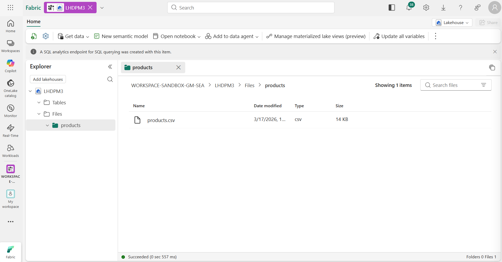
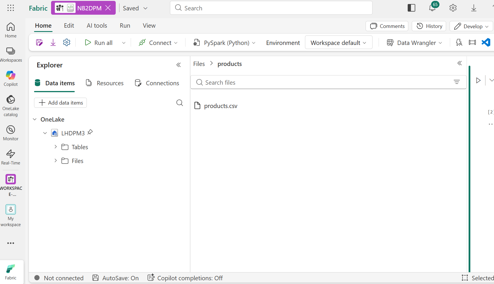

---
Lab:
    Title: 'Use delta tables in Apache Spark'
    Module: 'Work with Delta Lake tables in Microsoft Fabric'
---

# Use delta tables in Apache Spark

Tables in a Microsoft Fabric lakehouse are based on the open source *Delta Lake* format for Apache Spark. Delta Lake adds support for relational semantics for both batch and streaming data operations, and enables the creation of a Lakehouse architecture in which Apache Spark can be used to process and query data in tables that are based on underlying files in a data lake.

This exercise should take approximately **40** minutes to complete

> **Note**: You'll need a Microsoft Fabric license to complete this exercise. See [Getting started with Fabric](https://learn.microsoft.com/fabric/get-started/fabric-trial) for details of how to enable a free Fabric trial license. You will need a Microsoft *school* or *work* account to do this. If you don't have one, you can [sign up for a trial of Microsoft Office 365 E3 or higher](https://www.microsoft.com/microsoft-365/business/compare-more-office-365-for-business-plans).

## Table of Contents

- [A. Open the shared lakehouse](#a-open-the-shared-lakehouse)
- [B. Verify your schema, folder and source file](#b-verify-your-schema-folder-and-source-file)
- [C. Explore data in a dataframe](#c-explore-data-in-a-dataframe)
- [D. Create delta tables](#d-create-delta-tables)
- [E. Explore table versioning](#e-explore-table-versioning)

## A. Open the shared lakehouse

> **Important – shared environment**: All participants work in **one shared workspace and one shared lakehouse**, and the source data has already been uploaded. Use the same **`<Name>_<Role>`** identifier you created in Module 2 for your schema, your folder under **Files**, and any item you create in the workspace.

1. Sign into [Microsoft Fabric](https://app.fabric.microsoft.com) at `https://app.fabric.microsoft.com`.
2. At the bottom left, ensure that you have the **Fabric** icon, if it's still in **Power BI** icon, simply click and switch to the **Fabric** icon.
3. In the menu bar on the left, select **Workspaces** and open the workshop workspace, then open the shared lakehouse. The facilitator will announce the workspace and lakehouse names on the day.

## B. Verify your schema, folder and source file

1. In the **Lakehouse explorer** pane, verify that your schema **`<Name>_<Role>`** exists under **Tables**, and your subfolder **`<Name>_<Role>`** exists under **Files** (both were created in Module 2).
2. Expand **Files** and select the **products** folder; verify that the **products.csv** file is available, as shown here:

    

> **Note**: The **products** folder is a shared source. Only read from it; save everything you create in your own schema and folder.

## C. Explore data in a dataframe

1. Go back to the workspace, select **+New item**, and choose **Notebook**. Rename the notebook to **`<Name>_<Role>_Module3`** (the workspace is shared, so the name must be unique). Then, in the **Explorer** pane on the left, select **Add sources** > **Lakehouses**, and attach the shared lakehouse.

    After a few seconds, a new notebook containing a single *cell* will open. Notebooks are made up of one or more cells that can contain *code* or *markdown* (formatted text).

2. Select the existing cell in the notebook, which contains some simple code, and then use its **&#128465;** (*Delete*) icon at its top-right to remove it - you will not need this code.
3. In the **Lakehouse explorer** pane on the left, expand **Files** and select **products** to reveal a new pane showing the **products.csv** file you uploaded previously:

    

4. In the **...** menu for **products.csv**, select **Load data** > **Spark**. A new code cell containing the following code should be added to the notebook:

    ```python
   df = spark.read.format("csv").option("header","true").load("Files/products/products.csv")
   # df now is a Spark DataFrame containing CSV data from "Files/products/products.csv".
   display(df)
    ```

    > **Tip**: You can hide the pane containing the files on the left by using its **<<** icon. Doing so will help you focus on the notebook.

5. Use the **&#9655;** (*Run cell*) button on the left of the cell to run it.

    > **Note**: Since this is the first time you've run any Spark code in this notebook, a Spark session must be started. This means that the first run can take a minute or so to complete. Subsequent runs will be quicker.

6. When the cell command has completed, review the output below the cell, which should look similar to this:

    | Index | ProductID | ProductName | Category | ListPrice |
    | -- | -- | -- | -- | -- |
    | 1 | 771 | Mountain-100 Silver, 38 | Mountain Bikes | 3399.9900 |
    | 2 | 772 | Mountain-100 Silver, 42 | Mountain Bikes | 3399.9900 |
    | 3 | 773 | Mountain-100 Silver, 44 | Mountain Bikes | 3399.9900 |
    | ... | ... | ... | ... | ... |

## D. Create delta tables

You can save the dataframe as a delta table by using the `saveAsTable` method. Delta Lake supports the creation of both *managed* and *external* tables.

### Create a *managed* table

*Managed* tables are tables for which both the schema metadata and the data files are managed by Fabric. The data files for the table are created in the **Tables** folder.

1. Under the results returned by the first code cell, use the **+ Code** button to add a new code cell if one doesn't already exist. Then enter the following code in the new cell and run it:

    ```python
   df.write.format("delta").saveAsTable("<Lakehouse_Name>.<Name>_<Role>.managed_products")
    ```

    > **Note**: Replace `<Lakehouse_Name>` with the shared lakehouse name announced by the facilitator, and `<Name>_<Role>` with your own schema name. This applies to all the code in the rest of this module.

2. In the **Lakehouse explorer** pane, in the **...** menu for your schema, select **Refresh**. Then expand your schema and verify that the **managed_products** table has been created.

### Create an *external* table

You can also create *external* tables for which the schema metadata is defined in the metastore for the lakehouse, but the data files are stored in an external location.

1. Add another new code cell, and add the following code to it (DO NOT RUN THE CODE FIRST):

    ```python
   df.write.format("delta").saveAsTable("external_products", path="<abfs_path>/external_products")
    ```

2. Go to the **Lakehouse explorer** pane, in the **...** menu for **your own `<Name>_<Role>` folder** under **Files**, select **Copy ABFS path**.

    The ABFS path is the fully qualified path to your folder in the OneLake storage for the lakehouse, in your clipboard the path should be similar to this:

    *abfss://workspace@tenant-onelake.dfs.fabric.microsoft.com/lakehousename.Lakehouse/Files/Name_Role*

3. In the code you entered into the code cell, replace **<abfs_path>** with the path you have above in your clipboard so that the code saves the dataframe as an external table with data files in a folder named **external_products** inside your own folder. The full path should look similar to this (Note that you should only replace the "<abfs_path>" in "<abfs_path>/external_products"):

    *abfss://workspace@tenant-onelake.dfs.fabric.microsoft.com/lakehousename.Lakehouse/Files/Name_Role/external_products*
    Then you can run the code.

4. In the **Lakehouse explorer** pane, in the **...** menu for your schema, select **Refresh**. Then expand your schema and verify that the **external_products** table has been created.

5. In the **Lakehouse explorer** pane, in the **...** menu for your **`<Name>_<Role>`** folder under **Files**, select **Refresh**. Then expand the folder and verify that the **external_products** folder has been created for the table's data files.

### Compare *managed* and *external* tables

Let's explore the differences between managed and external tables.

1. Add another code cell and run the following code:

    ```sql
   %%sql

   DESCRIBE FORMATTED <Lakehouse_Name>.<Name>_<Role>.managed_products;
    ```

    In the results, view the **Location** property for the table, which should be a path to the OneLake storage for the lakehouse ending with **/Tables/<Name>_<Role>/managed_products** (you may need to widen the **Data type** column to see the full path).

2. Modify the `DESCRIBE` command to show the details of the **external_products** table as shown here:

    ```sql
   %%sql

   DESCRIBE FORMATTED external_products;
    ```

    In the results, view the **Location** property for the table, which should be a path to the OneLake storage for the lakehouse ending with **/Files/<Name>_<Role>/external_products** (you may need to widen the **Data type** column to see the full path).

    The files for managed table are stored in the **Tables** folder (under your schema) in the OneLake storage for the lakehouse. In this case, a folder named **managed_products** has been created to store the Parquet files and **delta_log** folder for the table you created.

3. Add another code cell and run the following code:

    ```sql
   %%sql

   DROP TABLE <Lakehouse_Name>.<Name>_<Role>.managed_products;
   DROP TABLE external_products;
    ```

4. In the **Lakehouse explorer** pane, in the **...** menu for your schema, select **Refresh**. Then expand your schema and verify that the **managed_products** and **external_products** tables are no longer listed.

5. In the **Lakehouse explorer** pane, expand the **Files** folder, then your **`<Name>_<Role>`** folder, and verify that the **external_products** folder has not been deleted. Select this folder to view the Parquet data files and **_delta_log** folder for the data that was previously in the **external_products** table. The table metadata for the external table was deleted, but the files were not affected.

### Use SQL to create a table

1. Add another code cell and run the following code:

    ```sql
   %%sql

   CREATE TABLE <Lakehouse_Name>.<Name>_<Role>.products
   USING DELTA
   LOCATION 'Files/<Name>_<Role>/external_products';
    ```

2. In the **Lakehouse explorer** pane, in the **...** menu for your schema, select **Refresh**. Then expand your schema and verify that a new table named **products** is listed. Then expand the table to verify that its schema matches the original dataframe that was saved in the **external_products** folder.

3. Add another code cell and run the following code:

    ```sql
   %%sql

   SELECT * FROM <Lakehouse_Name>.<Name>_<Role>.products;
   ```

## E. Explore table versioning

Transaction history for delta tables is stored in JSON files in the **delta_log** folder. You can use this transaction log to manage data versioning.

1. Add a new code cell to the notebook and run the following code:

    ```sql
   %%sql

   UPDATE <Lakehouse_Name>.<Name>_<Role>.products
   SET ListPrice = ListPrice * 0.9
   WHERE Category = 'Mountain Bikes';
    ```

    This code implements a 10% reduction in the price for mountain bikes.

2. Add another code cell and run the following code:

    ```sql
   %%sql

   DESCRIBE HISTORY <Lakehouse_Name>.<Name>_<Role>.products;
    ```

    The results show the history of transactions recorded for the table.

3. Add another code cell and run the following code:

    ```python
   delta_table_path = 'Files/<Name>_<Role>/external_products'

   # Get the current data
   current_data = spark.read.format("delta").load(delta_table_path)
   display(current_data)

   # Get the version 0 data
   original_data = spark.read.format("delta").option("versionAsOf", 0).load(delta_table_path)
   display(original_data)
    ```

    The results show two dataframes - one containing the data after the price reduction, and the other showing the original version of the data.

4. On the notebook Home menu ribbon, select the ■ icon (**Stop session**) to end the Spark session.
