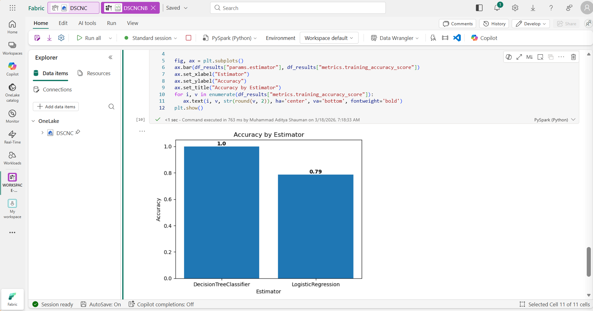

---
Lab:
    Title: 'Train a classification model to predict customer churn'
    Module: 'Get started with data science in Microsoft Fabric'
---

# Use notebooks to train a model in Microsoft Fabric

In this lab, we will use Microsoft Fabric to create a notebook and train a machine learning model to predict customer churn. We will use Scikit-Learn to train the model and MLflow to track its performance. Customer churn is a critical business problem that many companies face, and predicting which customers are likely to churn can help companies retain their customers and increase revenue. By completing this lab, you will gain hands-on experience in machine learning and model tracking, and learn how to use Microsoft Fabric to create a notebook for your projects.

This lab will take approximately **45** minutes to complete.

> **Note**: You'll need a Microsoft Fabric license to complete this exercise. See [Getting started with Fabric](https://learn.microsoft.com/fabric/get-started/fabric-trial) for details of how to enable a free Fabric trial license. You will need a Microsoft *school* or *work* account to do this. If you don't have one, you can [sign up for a trial of Microsoft Office 365 E3 or higher](https://www.microsoft.com/microsoft-365/business/compare-more-office-365-for-business-plans).

## Table of Contents

- [A. Open the shared lakehouse](#a-open-the-shared-lakehouse)
- [B. Verify the source file](#b-verify-the-source-file)
- [C. Create a notebook](#c-create-a-notebook)
- [D. Load data into a dataframe](#d-load-data-into-a-dataframe)
- [E. Train a machine learning model](#e-train-a-machine-learning-model)
- [F. Use MLflow to search and view your experiments](#f-use-mlflow-to-search-and-view-your-experiments)
- [G. Explore your experiments](#g-explore-your-experiments)
- [H. Save the model](#h-save-the-model)

## A. Open the shared lakehouse

> **Important – shared environment**: All participants work in **one shared workspace and one shared lakehouse**, and the source data has already been uploaded. Experiments and models are items in the shared workspace, so every name you create in this module must carry your own **`<Name>_<Role>`** identifier (the same one you used in the previous modules).

1. Sign into [Microsoft Fabric](https://app.fabric.microsoft.com) at `https://app.fabric.microsoft.com`.
2. At the bottom left, ensure that you have the **Fabric** icon, if it's still in **Power BI** icon, simply click and switch to the **Fabric** icon.
3. In the menu bar on the left, select **Workspaces** and open the workshop workspace, then open the shared lakehouse. The facilitator will announce the workspace and lakehouse names on the day.

## B. Verify the source file

1. In the **Lakehouse explorer** pane, expand the **Files** folder, then the **scenario5** folder, and verify that the **churn.csv** file is available.

> **Note**: The **scenario5** folder is a shared source. Only read from it. Do not modify or delete anything in it.

## C. Create a notebook

To train a model, you can create a *notebook*. Notebooks provide an interactive environment in which you can write and run code (in multiple languages) as *experiments*.

<!-- 1. At the bottom left of the Power BI portal, select the **Data engineering** icon and switch to the **Data science** experience. -->

1. In the Workspace home page, select **+New item** and search for **Notebook** to create one. Rename the notebook to **`<Name>_<Role>_Module5`** (the workspace is shared, so the name must be unique).

    After a few seconds, a new notebook containing a single *cell* will open. Notebooks are made up of one or more cells that can contain *code* or *markdown* (formatted text).

2. Select the first cell (which is currently a *code* cell), and then in the dynamic tool bar at its top-right, use the **M&#8595;** button to convert the cell to a *markdown* cell.

    When the cell changes to a markdown cell, the text it contains is rendered.

3. Use the **&#128393;** (Edit) button to switch the cell to editing mode, then delete the content and enter the following text:

    ```text
   # Train a machine learning model and track with MLflow

   Use the code in this notebook to train and track models.
    ``` 

## D. Load data into a dataframe

Now you're ready to run code to prepare data and train a model. To work with data, you'll use *dataframes*. Dataframes in Spark are similar to Pandas dataframes in Python, and provide a common structure for working with data in rows and columns.

1. In the **Explorer** pane, select **+ Add data items** to add a lakehouse.
2. Select **From OneLake catalog**.
3. Select the shared lakehouse announced by the facilitator, and confirm.
4. Expand the **Files** folder, then the **scenario5** folder, so that the CSV file is listed next to the notebook editor.
5. In the **...** menu for **churn.csv**, select **Load data** > **Pandas**. A new code cell containing the following code should be added to the notebook:

    ```python
   import pandas as pd
   # Load data into pandas DataFrame from "/lakehouse/default/" + "Files/scenario5/churn.csv"
   df = pd.read_csv("/lakehouse/default/" + "Files/scenario5/churn.csv")
   display(df)
    ```

    > **Tip**: You can hide the pane containing the files on the left by using its **<<** icon. Doing so will help you focus on the notebook.

6. Use the **&#9655; Run cell** button on the left of the cell to run it.

    > **Note**: Since this is the first time you've run any Spark code in this session, the Spark pool must be started. This means that the first run in the session can take a minute or so to complete. Subsequent runs will be quicker.

7. When the cell command has completed, review the output below the cell, which should look similar to this:

    |Index|CustomerID|years_with_company|total_day_calls|total_eve_calls|total_night_calls|total_intl_calls|average_call_minutes|total_customer_service_calls|age|churn|
    | -- | -- | -- | -- | -- | -- | -- | -- | -- | -- | -- |
    |1|1000038|0|117|88|32|607|43.90625678|0.810828179|34|0|
    |2|1000183|1|164|102|22|40|49.82223317|0.294453889|35|0|
    |3|1000326|3|116|43|45|207|29.83377967|1.344657937|57|1|
    |4|1000340|0|92|24|11|37|31.61998183|0.124931779|34|0|
    | ... | ... | ... | ... | ... | ... | ... | ... | ... | ... | ... |

    The output shows the rows and columns of customer data from the churn.csv file.

## E. Train a machine learning model

Now that you've loaded the data, you can use it to train a machine learning model and predict customer churn. You'll train a model using the Scikit-Learn library and track the model with MLflow. 

1. Use the **+ Code** icon below the cell output to add a new code cell to the notebook, and enter the following code in it:

    ```python
   from sklearn.model_selection import train_test_split

   print("Splitting data...")
   X, y = df[['years_with_company','total_day_calls','total_eve_calls','total_night_calls','total_intl_calls','average_call_minutes','total_customer_service_calls','age']].values, df['churn'].values
   
   X_train, X_test, y_train, y_test = train_test_split(X, y, test_size=0.30, random_state=0)
    ```

2. Run the code cell you added, and note you're omitting 'CustomerID' from the dataset, and splitting the data into a training and test dataset.
3. Add another new code cell to the notebook, enter the following code in it, and run it:
    
    ```python
   import mlflow
   experiment_name = "experiment-churn-<Name>_<Role>"
   mlflow.set_experiment(experiment_name)
    ```
    
    > **Note**: Replace `<Name>_<Role>` with your own identifier. Experiments are items in the shared workspace, so a unique name keeps your runs separate from other participants'.

    The code creates an MLflow experiment named `experiment-churn-<Name>_<Role>`. Your models will be tracked in this experiment.

4. Add another new code cell to the notebook, enter the following code in it, and run it:

    ```python
   from sklearn.linear_model import LogisticRegression
   
   with mlflow.start_run():
       mlflow.autolog()

       model = LogisticRegression(C=1/0.1, solver="liblinear").fit(X_train, y_train)

       mlflow.log_param("estimator", "LogisticRegression")
    ```
    
    The code trains a classification model using Logistic Regression. Parameters, metrics, and artifacts, are automatically logged with MLflow. Additionally, you're logging a parameter called `estimator`, with the value `LogisticRegression`.

5. Add another new code cell to the notebook, enter the following code in it, and run it:

    ```python
   from sklearn.tree import DecisionTreeClassifier
   
   with mlflow.start_run():
       mlflow.autolog()

       model = DecisionTreeClassifier().fit(X_train, y_train)
   
       mlflow.log_param("estimator", "DecisionTreeClassifier")
    ```

    The code trains a classification model using Decision Tree Classifier. Parameters, metrics, and artifacts, are automatically logged with MLflow. Additionally, you're logging a parameter called `estimator`, with the value `DecisionTreeClassifier`.

## F. Use MLflow to search and view your experiments

When you've trained and tracked models with MLflow, you can use the MLflow library to retrieve your experiments and its details.

1. To list all experiments, use the following code (the shared workspace contains the experiments of all participants, so look for the one ending with your own identifier):

    ```python
   import mlflow
   experiments = mlflow.search_experiments()
   for exp in experiments:
       print(exp.name)
    ```

2. To retrieve a specific experiment, you can get it by its name (replace `<Name>_<Role>` with your own identifier):

    ```python
   experiment_name = "experiment-churn-<Name>_<Role>"
   exp = mlflow.get_experiment_by_name(experiment_name)
   print(exp)
    ```

3. Using an experiment name, you can retrieve all jobs of that experiment:

    ```python
   mlflow.search_runs(exp.experiment_id)
    ```

4. To more easily compare job runs and outputs, you can configure the search to order the results. For example, the following cell orders the results by `start_time`, and only shows a maximum of `2` results: 

    ```python
   mlflow.search_runs(exp.experiment_id, order_by=["start_time DESC"], max_results=2)
    ```

5. Finally, you can plot the evaluation metrics of multiple models next to each other to easily compare models:

    ```python
   import matplotlib.pyplot as plt
   
   df_results = mlflow.search_runs(exp.experiment_id, order_by=["start_time DESC"], max_results=2)[["metrics.training_accuracy_score", "params.estimator"]]
   
   fig, ax = plt.subplots()
   ax.bar(df_results["params.estimator"], df_results["metrics.training_accuracy_score"])
   ax.set_xlabel("Estimator")
   ax.set_ylabel("Accuracy")
   ax.set_title("Accuracy by Estimator")
   for i, v in enumerate(df_results["metrics.training_accuracy_score"]):
       ax.text(i, v, str(round(v, 2)), ha='center', va='bottom', fontweight='bold')
   plt.show()
    ```

    The output should resemble the following image:

    
6. In the notebook menu bar, use the ⚙️ **Settings** icon to view the notebook settings.
7. Make sure the **Name** of the notebook is still **`<Name>_<Role>_Module5`**, and then close the settings pane.
8. On the notebook Home menu ribbon, select the ■ icon (**Stop session**) to end the session.

## G. Explore your experiments

Microsoft Fabric will keep track of all your experiments and allows you to visually explore them.

1. On the left pane, navigate to the workshop workspace.
2. Select your own `experiment-churn-<Name>_<Role>` experiment from the list in the Workspace view (the workspace contains the experiments of all participants, so make sure you open yours).

    > **Tip:**
    > If you don't see any logged experiment runs, refresh the page.

3. Select the **View** tab.
4. Select **Run list**. 
5. Select the two latest runs by checking each box.
    As a result, your two last runs will be compared to each other in the **Metric comparison** pane. By default, the metrics are plotted by run name. 
6. Select the **&#128393;** (Edit) button of the graph visualizing the accuracy for each run. 
7. Change the **visualization type** to `bar`. 
8. Change the **X-axis** to `estimator`. 
9. Select **Replace** and explore the new graph.

By plotting the accuracy per logged estimator, you can review which algorithm resulted in a better model.

## H. Save the model

After comparing machine learning models that you've trained across experiment runs, you can choose the best performing model. To use the best performing model, save the model and use it to generate predictions.

1. In the experiment overview, ensure the **View** tab is selected.
2. Select **Run details**.
3. Select the run with the highest accuracy. 
4. Select **Save** in the **Save run as an ML model** box.
5. Select **Create a new model** in the newly opened pop-up window.
6. Name the model `model-churn-<Name>_<Role>` (replace with your own identifier, since models are also items in the shared workspace), and select **Save**. 
7. A pop-up notification will appear in the top right below your profile icon, select **View ML model**. You can also refresh the window. The saved model is linked under Registered version. If you miss the pop-up you can go to the workshop workspace and the model should be saved as a new item.

Note that the model, the experiment, and the experiment run are linked, allowing you to review how the model is trained. 

<!-- ## Save the notebook and end the Spark session

Now that you've finished training and evaluating the models, you can save the notebook with a meaningful name and end the Spark session.

1. In the notebook menu bar, use the ⚙️ **Settings** icon to view the notebook settings.
2. Set the **Name** of the notebook to **Train and compare models**, and then close the settings pane.
3. On the notebook menu, select **Stop session** to end the Spark session. -->
