---
Lab:
    Title: 'Get started with Real-Time Analytics in Microsoft Fabric'
    Module: 'Get started with Real-Time Analytics in Microsoft Fabric'
---
# Get started with eventstreams in Real-Time Analytics (RTA)

Eventstreams is a feature in Microsoft Fabric that captures, transforms, and routes real-time events to various destinations with a no-code experience. You can add event data sources, routing destinations, and the event processor when the transformation is needed, to the eventstream. Microsoft Fabric's EventStore is a monitoring option that maintains events from the cluster and provides a way to understand the state of your cluster or workloads at a given point in time. The EventStore service can be queried for events that are available for each entity and entity type in your cluster. This means you can query for events on different levels such as cluster, nodes, applications, services, partitions, and partition replicas. The EventStore service also has the ability to correlate events in your cluster. By looking at events that were written at the same time from different entities that may have impacted each other, the EventStore service is able to link these events to help with identifying causes for activities in your cluster. Another option for monitoring and diagnostics of Microsoft Fabric clusters is aggregating and collecting events using EventFlow.

This lab takes approximately **30** minutes to complete.

> **Note**: You'll need a Microsoft Fabric license to complete this exercise. See [Getting started with Fabric](https://learn.microsoft.com/fabric/get-started/fabric-trial) for details of how to enable a free Fabric trial license. You will need a Microsoft *school* or *work* account to do this. If you don't have one, you can [sign up for a trial of Microsoft Office 365 E3 or higher](https://www.microsoft.com/microsoft-365/business/compare-more-office-365-for-business-plans).

## Table of Contents

- [A. Scenario](#a-scenario)
- [B. Create a workspace](#b-create-a-workspace)
- [C. Create a KQL Database in Eventhouse](#c-create-a-kql-database-in-eventhouse)
- [D. Create an Eventstream](#d-create-an-eventstream)
- [E. Establish an eventstream source and destination](#e-establish-an-eventstream-source-and-destination)
- [F. KQL Queries](#f-kql-queries)
- [G. Sample SQL Queries](#g-sample-sql-queries)
- [H. Clean up resources (Optional)](#h-clean-up-resources-optional)

## A. Scenario

With Fabric eventstreams, you can easily manage your event data in one place. You can collect, transform, and send real-time event data to different destinations in the format you want. You can also connect your eventstreams with Azure Event Hubs, KQL database in Eventhouse, and Lakehouse without any hassle.

This lab is based on sample streaming data called Stock Market Data. The Stock Market sample data is a dataset of a stock exchange with a preset schema column such as time, symbol, price, volume and more. You'll use this sample data to simulate real-time events of stock prices and analyze them with various destinations, such as the KQL database in Eventhouse.

Use Real-Time Analytics streaming and query capabilities to answer key questions about the stock statistics. In this scenario, we're going to take full advantage of the wizard instead of manually creating some components independently, such as the KQL Database in Eventhouse.

In this tutorial, you'll learn how to:

- Create a KQL database in Eventhouse
- Enable data copy to OneLake
- Create an eventstream
- Stream data from an eventstream to your KQL database in Eventhouse
- Explore data with KQL and SQL

## B. Create a workspace

Before working with data in Fabric, create a workspace with the Fabric trial enabled.

1. Sign into [Microsoft Fabric](https://app.fabric.microsoft.com) at `https://app.fabric.microsoft.com` and ensure **Fabric** icon in the bottom left selected.
2. In the menu bar on the left, select **Workspaces** (the icon looks similar to &#128455;).
3. Create a new workspace with a name of your choice, selecting a licensing mode that includes Fabric capacity (*Trial*, *Premium*, or *Fabric*).
4. When your new workspace opens, it should be empty, as shown here:

   

## C. Create a KQL Database in Eventhouse

1. Within the **Fabric Workspace view**, choose **+New Item** then search and select the **Eventhouse** option.

   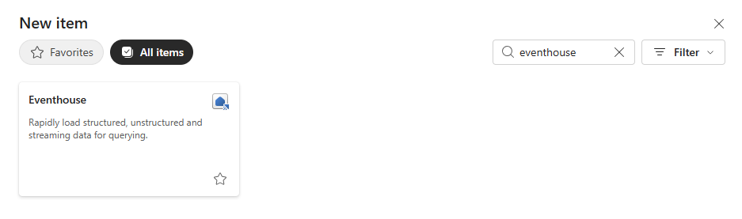

2. You'll be prompted to **Name** the Eventhouse

   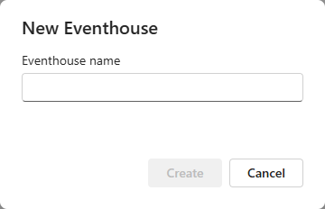

3. Give the Eventhousse a name of your preference, then **Create**.

1. In the **Eventhouse details** panel on the left, select  the auto-created KQL database, then on the right navigate to the OneLake dropdown by expanding.

   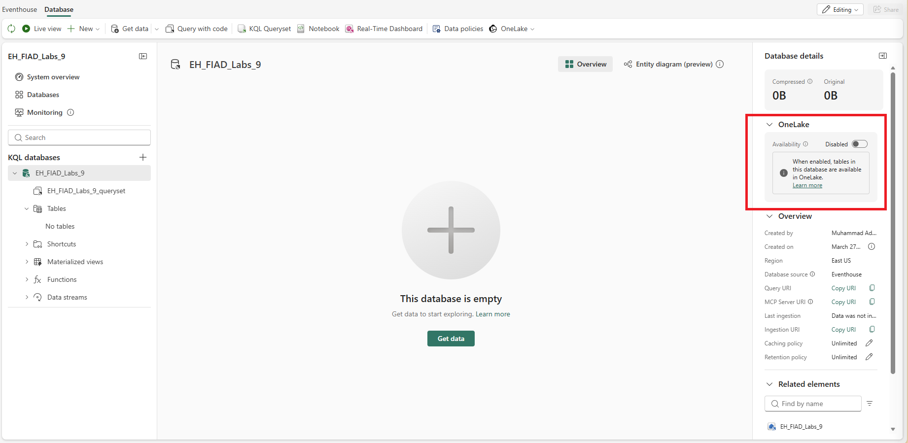

2. Make sure to toggle the button to **Active**.

   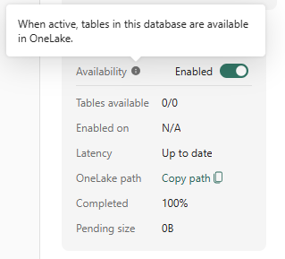

## D. Create an Eventstream

1. Navigate back to the **Fabric Workspace view**
2. Select **+New item**, then search and select **EventStream**

   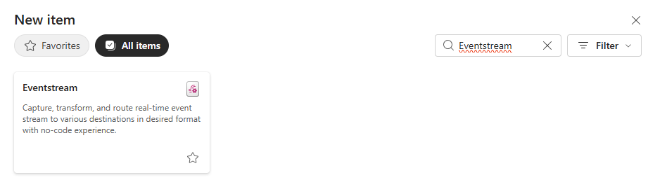

3. You'll be prompted to **Name** your eventstream. Give the EventStream a name of your choice, press the **Create** button.

   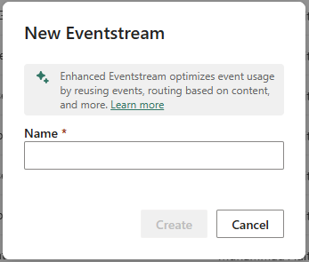

## E. Establish an eventstream source and destination

1. In the Eventstream canvas, select the **Use Sample Data** or you can also do it by choosing **Add source > Sample data**.

   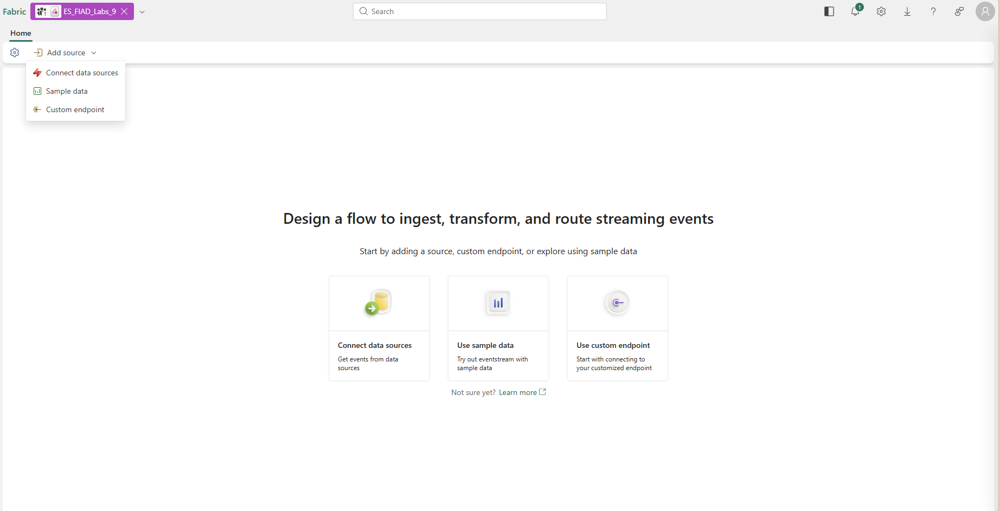

2. Enter the values for your Sample Data as shown in the following table and then select **Add and Configure**.

   | Field       | Recommended Value |
   | ----------- | ----------------- |
   | Source name | StockData         |
   | Sample data | Stock Market (high data-rate)     |

3. Now add a destination by selecting **Transform events or add destination** and then select **Eventhouse**

   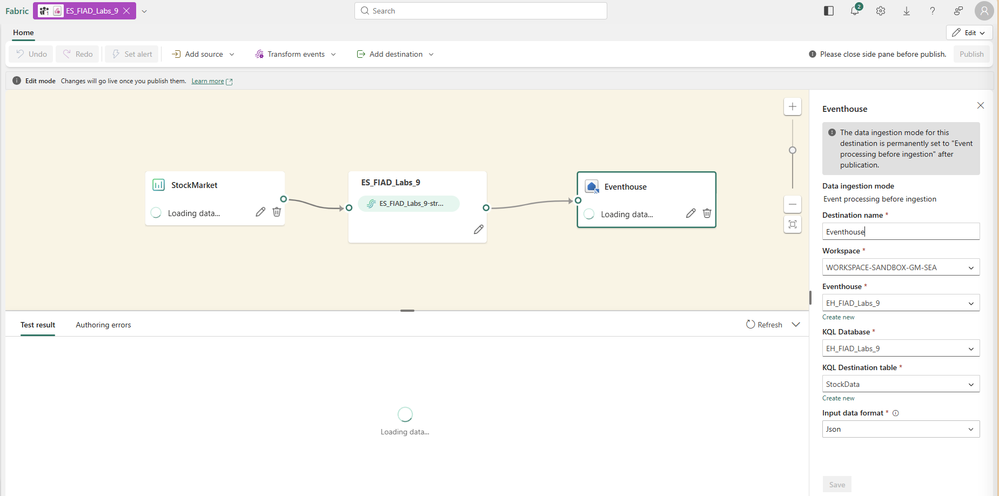

4. In the KQL Database configuration use the following table to complete the configuration.

   | Field            | Recommended Value                              |
   | ---------------- | ---------------------------------------------- |
   | Destination Name | Your Eventhouse                                    |
   | Workspace        | The workspace where you created the KQL database in Eventhouse |
   | KQL Database     | Your KQL Database
   KQL Destination Table     | Create New > StockData                                 |

3. Select **Save**.

<!-- ## Configure data ingestion

1. In the **Ingest data** dialogue page, Select the **New Table**, enter MyStockData.

   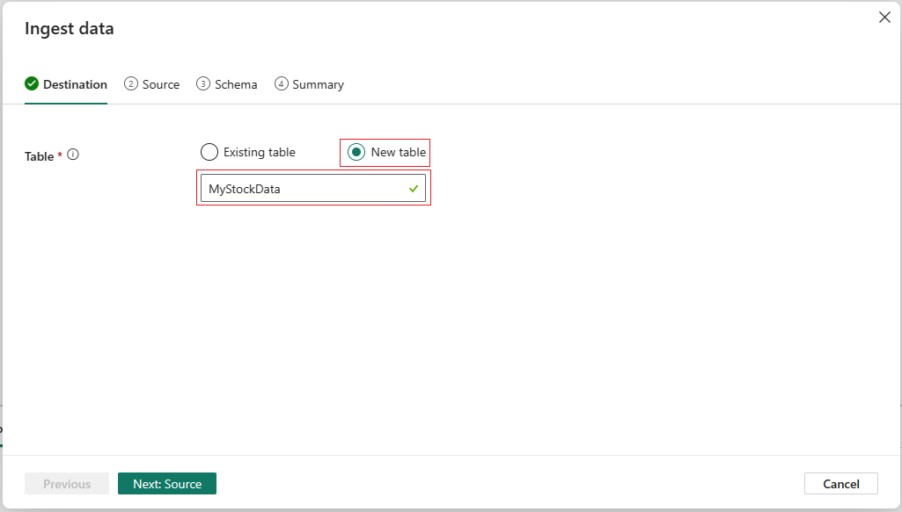

2. Select **Next: Source**.
3. In the **Source** page confirm the **Data connection name**, then select **Next: Schema**.

   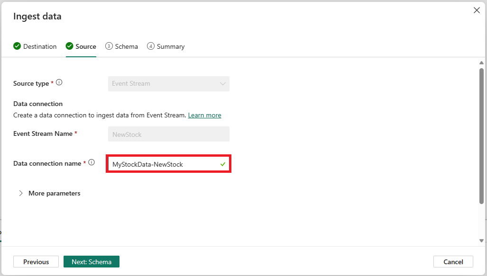

4. The incoming data is uncompressed for sample data, so keep the compression type as uncompressed.
5. From the **Data Format** dropdown, select **JSON**.

   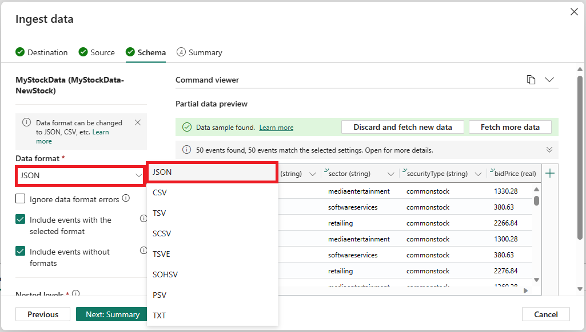

6. After that, it may be necessary to change some or all data types from your incoming stream to your destination(s) tables.
7. You can accomplish this task by selecting the **down arrow>Change data type**. Then verify that the columns reflect the correct data type:

   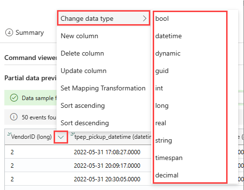

8. When finished, select **Next: Summary**

Wait for all the steps to be marked with green check marks. You should see the page title **Continuous ingestion from Eventsream established.** After that, select **Close** to return to your Eventstream page.

> **Note**: It may be necessary to refresh the page to view your table after the Eventstream connection has been built and established -->

## F. KQL Queries

Kusto Query Language (KQL) is a read-only request to process data and return results. The request is stated in plain text, using a data-flow model that is easy to read, author, and automate. Queries always run in the context of a particular table or database. At a minimum, a query consists of a source data reference and one or more query operators applied in sequence, indicated visually by the use of a pipe character (|) to delimit operators. For more information on the Kusto Query Language, see [Kusto Query Language (KQL) Overview](https://learn.microsoft.com/en-us/azure/data-explorer/kusto/query/?context=%2Ffabric%2Fcontext%2Fcontext)

> **Note**: The KQL Editor comes with both syntax and Inellisense highlighting, which allows you to quickly gain knowledge of the Kusto Query Language (KQL).

1. Browse to your newly created and hydrated **KQL table** in your **Eventhouse** by selecting the **KQL database** in the left pane.
2. By expanding your **KQL database** drop-down, select the **StockData** table, then select the **Query with code** in upper pane. Choose to **Show any 100 records**.

   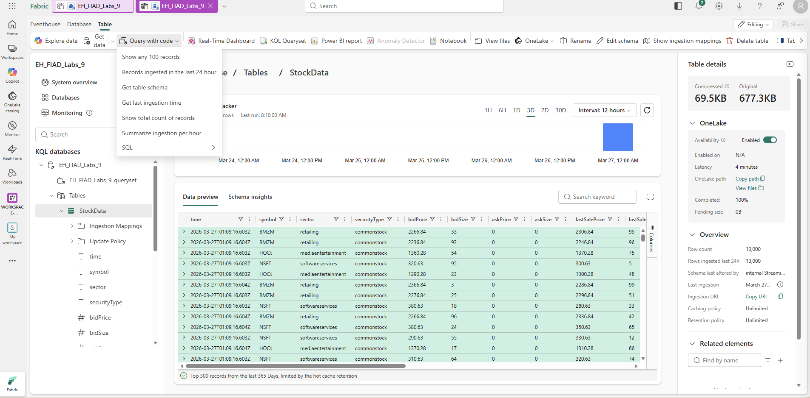

3. The sample query opens in the new **Queryset** pane. This first query uses the take operator to return a sample number of records, and is useful to get a first look at the data structure and possible values. The auto populated sample queries are automatically run. You can see the query results in the **Table** below.

   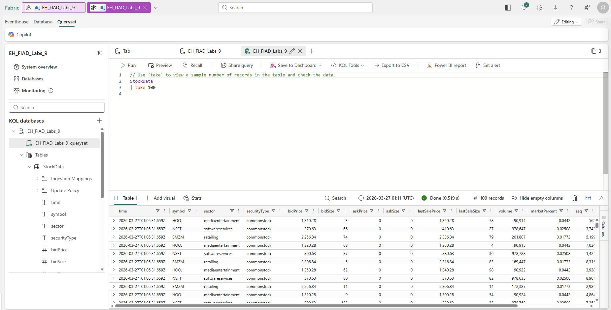

4. Navigate back to the KQL table to select the next query, choose **Query with code > Records ingested in the last 24 hour** which uses the where operator and between operator to return records ingested in the last 24 hours.

   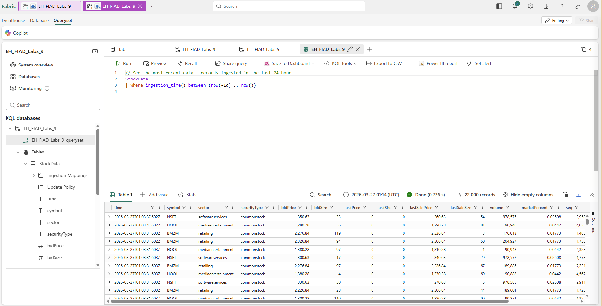

> **Note**: Notice that the volumes of the streaming data exceed the query limits. This behavior may vary depending on the amount of data streamed into your database.

You can continue to navigate using the built-in query functions to familiarize yourself with your data.

## G. Sample SQL Queries

The query editor supports the use of T-SQL in addition to its primary query Kusto Query Language (KQL). T-SQL can be useful for tools that are unable to use KQL. For more information, see [Query data using T-SQL](https://learn.microsoft.com/en-us/azure/data-explorer/t-sql)

1. Back to the KQL table, select the **Query with code**. Select **SQL > Show any 100 records**.

   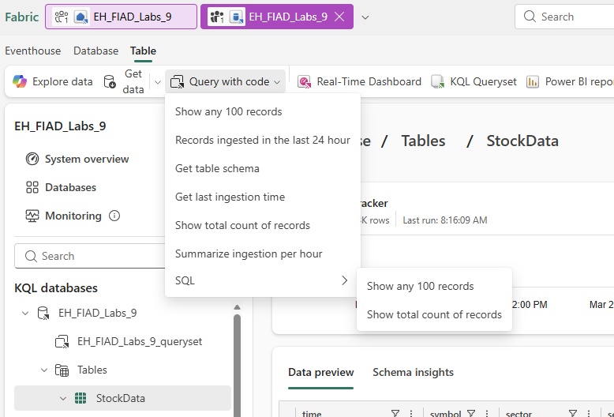

2. You can click the Run button to run the query.

   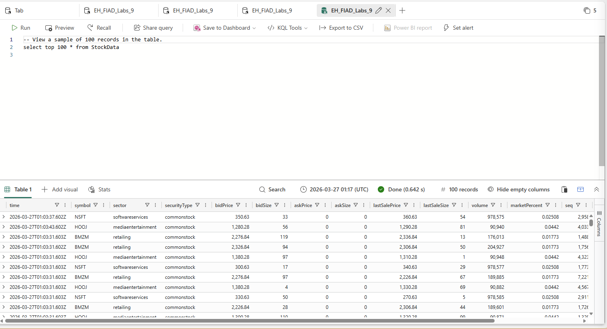

You can continue to navigate using the build-in functions and familiarize yourself with the data using SQL or KQL. This ends the lesson.

## H. Clean up resources (Optional)

In this exercise, you have created a KQL database and set up continuous streaming with eventstream. After that you queried the data using KQL and SQL. When you've finished exploring your KQL database, you can delete the workspace you created for this exercise.
1. In the bar on the left, select the icon for your workspace.
2. In the ... menu on the toolbar, select Workspace settings.
3. In the Other section, select Remove this workspace.